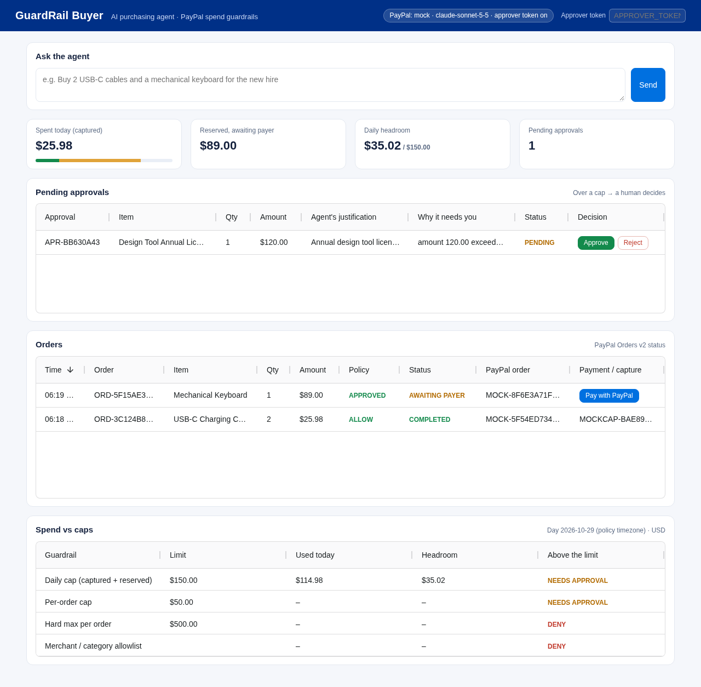

# GuardRail Buyer

> An AI purchasing agent that pays with PayPal — but only inside the spend guardrails you set.

*Draft README — work in progress for the PayPal AI Hackathon.*



Letting an AI agent spend money is risky. GuardRail Buyer puts a deterministic
policy engine between the LLM and the wallet:

| Rule | Effect |
|---|---|
| Per-order cap (default $50) | above it → **NEEDS_APPROVAL** (a human must approve) |
| Daily cap (default $150, per policy timezone) | today's spend + this order above it → **NEEDS_APPROVAL** |
| Hard maximum per order (default $500) | above it → **DENY** |
| Merchant allowlist / blocklist | not allowed → **DENY** |
| Category allowlist | not allowed → **DENY** |
| Currency must match policy | otherwise → **DENY** |

The agent (Claude, via tool use) can search the catalog, dry-run the policy,
place an order, or ask for human approval. **It never calls PayPal directly** —
every order goes through `BuyerService`, which re-evaluates the policy on the
server. A DENY can never be escalated to approval, and approving a request
re-checks the deny rules in case the policy changed.

## Architecture

```
natural-language request
        │
        ▼
 Claude agent (Messages API, tool use)        app/agent.py
   tools: search_catalog · check_policy · create_order · request_approval
        │
        ▼
 BuyerService ── guardrail engine (pure) ── SpendLedger (SQLite)   app/service.py, app/guardrails.py
        │
        ▼
 PayPalClient: MockPayPal | SandboxPayPal (Orders v2)              app/paypal_client.py
        │   create order → buyer approves on PayPal → /paypal/return → capture
        ▼
 FastAPI: REST API + AG Grid dashboard at /                        app/main.py, app/static/
```

### Payment flow and spend accounting

1. A policy-ALLOWed (or human-approved) order is created with PayPal Orders v2 (`intent: CAPTURE`,
   `PayPal-Request-Id` = our order id for idempotency). PayPal returns `PAYER_ACTION_REQUIRED` and a
   `payer-action` link, shown as **Pay with PayPal** in the dashboard.
2. The buyer approves on PayPal and is redirected to `GET /paypal/return?token=<paypal order id>`,
   which captures the order (idempotent: a refresh does not capture twice) and redirects to the dashboard.
3. `GET /paypal/cancel?token=…` marks the order `CANCELLED`.

| Order status | Counts toward the daily cap? |
|---|---|
| `PAYER_ACTION_REQUIRED` (created, awaiting buyer) | **yes, reserved** — so an agent cannot open many unpaid orders to dodge the cap |
| `COMPLETED` (captured) | yes, captured |
| `CANCELLED` / `EXPIRED` / `CAPTURE_FAILED` | no — reservation released |
| `FAILED` (PayPal create failed) | never reserved |

Unapproved orders expire after `PAYPAL_APPROVAL_TTL_MIN` (default 180 min); expiry is checked
lazily on reads and on return. A reservation stays on the day it was made (policy timezone).
`GET /spend` reports `captured`, `reserved`, `total` and `remaining` against the caps.

## Quick start

Requires Python 3.11+.

```bash
pip install -r requirements.txt
cp .env.example .env          # add ANTHROPIC_API_KEY (or point ANTHROPIC_BASE_URL at a gateway)
```

`.env` is loaded automatically (python-dotenv); real environment variables win.

### Repro steps ("do X → see Y")

1. **Run the tests** — `python -m pytest -q` → see `50 passed` (no network, no API key needed).
2. **Start the app** — `APPROVER_TOKEN=demo PAYPAL_MOCK_APPROVAL=1 uvicorn app.main:app --port 8000` →
   open <http://localhost:8000/> for the dashboard (or `/docs` for Swagger). Enter `demo` in the
   *Approver token* box. `PAYPAL_MOCK_APPROVAL=1` makes the offline mock behave like the real
   Sandbox: every order waits for a buyer approval on a local mock checkout page.
3. **Check the policy** — `curl localhost:8000/policy` → see the caps, allowlists and `"spent_today": "0.00"`.
4. **Ask the agent to buy something mixed** —
   ```bash
   curl -X POST localhost:8000/agent/request -H 'content-type: application/json' \
     -d '{"request":"Buy 2 USB-C charging cables and a mechanical keyboard for our new hire, and also a $100 gift card as a welcome present."}'
   ```
   (or type it into *Ask the agent* on the dashboard) → the cables ($25.98) get a PayPal order
   (**Pay with PayPal**, $25.98 reserved), the keyboard ($89) gets an **approval request**, and the
   gift card is **refused** (blocked merchant + category). See `docs/sample_transcript.json` for a real run.
   Click **Pay with PayPal** → approve → you land back on the dashboard with the order `COMPLETED`.
5. **See what is waiting for you** — `curl localhost:8000/approvals?status=PENDING` → see the keyboard approval with the agent's justification and the policy reasons.
6. **Approve it** — click **Approve** in *Pending approvals*, or
   `curl -X POST -H 'X-Approver-Token: demo' localhost:8000/approvals/<APR-id>/approve` → a new order
   linked to the approval, awaiting the buyer; `GET /spend` shows `total: 114.98`. Without the token → `401`.
7. **Or reject it** — **Reject** / `POST /approvals/<APR-id>/reject` → status `REJECTED`, no money moves.
8. **One-shot from the CLI** — `python -m app.cli "3 bags of coffee beans and 2 snack boxes"` → see each tool call and its verdict (see `docs/sample_cli_run.txt`).

### Against the real PayPal Sandbox

```bash
PAYPAL_MODE=sandbox PAYPAL_CLIENT_ID=… PAYPAL_CLIENT_SECRET=… uvicorn app.main:app --port 8000
```

Ask the agent for something small, click **Pay with PayPal** (opens `sandbox.paypal.com/checkoutnow`),
log in with a Sandbox *personal* test account from the PayPal developer dashboard and pay → PayPal
redirects to `/paypal/return`, the order is captured and shows `COMPLETED` with its capture id.

### Changing the policy

Edit `policy.yaml` (or point `POLICY_PATH` at a `.json` file) and restart. Example: set
`per_order_cap: 100` → the keyboard in step 4 is bought directly instead of needing approval.

## REST API

| Method | Path | Description |
|---|---|---|
| POST | `/agent/request` | `{"request": "..."}` — run the agent; returns final text, transcript, token usage |
| GET | `/orders` | all orders (`?status=COMPLETED`) with the policy decision attached |
| GET | `/approvals` | approval requests (`?status=PENDING`) |
| POST | `/approvals/{id}/approve` | approve → re-check deny rules → PayPal order (needs `X-Approver-Token` when `APPROVER_TOKEN` is set) |
| POST | `/approvals/{id}/reject` | reject, nothing is paid (same token) |
| GET | `/paypal/return?token=…` | PayPal redirect after buyer approval → capture |
| GET | `/paypal/cancel?token=…` | PayPal redirect on cancel → release reservation |
| GET | `/spend` | today's captured / reserved / remaining vs caps |
| GET | `/policy` | active policy + today's spend |
| GET | `/` | AG Grid dashboard |
| GET | `/catalog` | demo products (`?q=keyboard`) |
| GET | `/health` | PayPal mode + model |

## Configuration

| Env var | Default | Notes |
|---|---|---|
| `ANTHROPIC_BASE_URL` | `https://api.anthropic.com` | any Messages-API-compatible endpoint |
| `ANTHROPIC_API_KEY` | – | sent as `x-api-key` if set |
| `MODEL` | `claude-sonnet-5-5` | |
| `PAYPAL_MODE` | `mock` | `sandbox` uses the real PayPal Sandbox |
| `PAYPAL_MOCK_APPROVAL` | `0` | mock only: `1` = orders wait for a simulated buyer approval |
| `PAYPAL_AUTH` | `oauth` | `oauth`: client id + secret → OAuth2 token → Bearer. `proxy`: no credentials in the app, an egress proxy injects `Authorization: Basic` |
| `PAYPAL_CLIENT_ID` / `PAYPAL_CLIENT_SECRET` | – | Sandbox REST app credentials (`oauth` mode) |
| `PUBLIC_BASE_URL` | `http://localhost:8000` | base of the PayPal return / cancel URLs |
| `PAYPAL_APPROVAL_TTL_MIN` | `180` | unapproved orders expire and release their reservation |
| `APPROVER_TOKEN` | – | required for approve / reject; empty = open (dev only, logs a warning) |
| `POLICY_PATH`, `CATALOG_PATH`, `DB_PATH` | `policy.yaml`, `data/catalog.json`, `guardrail.db` | |

## Status / roadmap

- [x] Guardrail engine + SQLite daily spend ledger, unit-tested
- [x] FastAPI backend with approvals workflow, MockPayPal
- [x] Claude tool-use agent wired to the guardrails
- [x] Buyer-approval round trip (create → approve → return → capture), reservations, cancel / expiry — tested with the mock and a wire-format test of the Sandbox client
- [ ] Live run against the PayPal Sandbox (waiting on credentials binding)
- [x] AG Grid dashboard for orders, approvals and spend, approver token
- [ ] Demo video

## AI tools used

- **Claude (Anthropic)** — `claude-sonnet-5-5` is the runtime purchasing agent (tool use via the Messages API).
- **Hark** (an AI agent, built on Claude) was used as a coding assistant to scaffold the backend, guardrail engine, tests and this README. All code was reviewed and tested by running the test suite and live agent calls.

## License

MIT — see [LICENSE](LICENSE).
